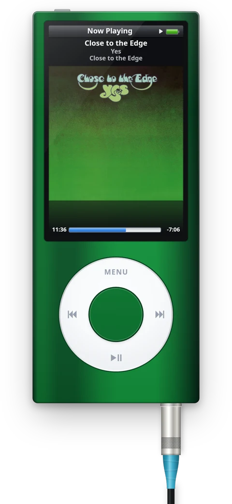

# KliqPlayer

A click-wheel music player that floats on your desktop: seventeen iPod models from 2001 to 2010, redrawn to look, click and
behave like the real ones. Play your own music or your Spotify library. For macOS, Windows and Linux.

**→ [kliqplayer.pages.dev](https://kliqplayer.pages.dev)**

## Install

Download the latest release:

| | Requires | Download |
|---|---|---|
| **Mac** | macOS 12 or later | [KliqPlayer-macos.zip](https://github.com/Perzivalle/kliqplayer/releases/latest/download/KliqPlayer-macos.zip) |
| **Windows** | Windows 10 or 11, 64-bit | [KliqPlayer-windows-x64.zip](https://github.com/Perzivalle/kliqplayer/releases/latest/download/KliqPlayer-windows-x64.zip) |
| **Linux** | x86-64, X11 or Wayland, libmpv | [KliqPlayer-linux-x64.tar.gz](https://github.com/Perzivalle/kliqplayer/releases/latest/download/KliqPlayer-linux-x64.tar.gz) |

On Linux, unpack and run `./install.sh`: it adds KliqPlayer to your app menu and tells you if libmpv is missing.

All versions: [Releases](https://github.com/Perzivalle/kliqplayer/releases).

## License

[MIT](LICENSE). Not affiliated with or endorsed by Apple Inc. iPod is a trademark of Apple Inc.

Building and code notes (in French): [docs/DEVELOPMENT.md](docs/DEVELOPMENT.md).
